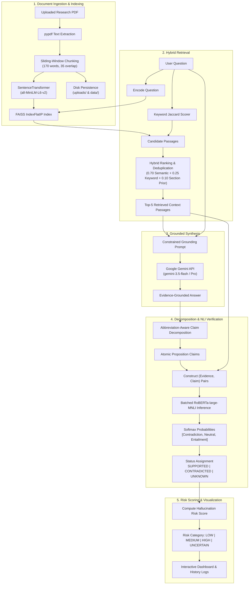

# LLM Hallucination Detector 🔍📑

[](https://www.python.org/)
[](https://fastapi.tiangolo.com/)
[](https://pytorch.org/)
[](https://huggingface.co/)
[](https://ai.google.dev/)
[](https://github.com/facebookresearch/faiss)
[](https://render.com)
[](LICENSE)

An end-to-end, evidence-grounded Question Answering and claim-level hallucination verification system for academic research papers and complex PDF documents. 

By combining **Hybrid Vector + Lexical Retrieval (RAG)** with strict **Google Gemini generation** and **Natural Language Inference (RoBERTa-large-MNLI)** cross-examination, this system decomposes generated answers into atomic factual claims, independently verifies each claim against source document passages, and computes a deterministic hallucination risk score.

---

## 📌 Table of Contents

- [Overview & Motivation](#-overview--motivation)
- [System Architecture](#-system-architecture)
- [Core Features](#-core-features)
- [Verification & Scoring Methodology](#-verification--scoring-methodology)
- [Empirical Benchmark (HaluEval)](#-empirical-benchmark-halueval)
- [Web Dashboard UI](#-web-dashboard-ui)
- [REST API Reference](#-rest-api-reference)
- [Local Setup & Installation](#-local-setup--installation)
- [Configuration Reference](#-configuration-reference)
- [Production Deployment (Render)](#-production-deployment-render)
- [Project Structure](#-project-structure)
- [Limitations & Roadmap](#-limitations--roadmap)
- [License](#-license)

---

## 💡 Overview & Motivation

Large Language Models (LLMs) frequently exhibit **hallucinations**—generating fluent, authoritative assertions that lack factual foundation or directly contradict source material. In scientific research, clinical literature, and legal analysis, unchecked hallucinations can lead to invalid conclusions or dangerous misinformation.

Existing evaluation approaches often rely on naive string matching or uncalibrated "LLM-as-a-judge" prompting, which can reproduce the very hallucinations they aim to detect. 

**LLM Hallucination Detector** addresses this by employing a deterministic, multi-stage verification pipeline:
1. **Source Grounding**: Retrieves exact source context chunks using semantic embeddings + keyword matching.
2. **Constrained Generation**: Instructs Gemini to synthesize an answer derived *strictly* from the retrieved passages.
3. **Atomic Claim Extraction**: Isolates individual propositions while safeguarding academic abbreviations (`et al.`, `i.e.`, `Fig.`).
4. **NLI Cross-Examination**: Evaluates each (evidence, claim) pair via a fine-tuned sequence classification model (`roberta-large-mnli`) into *Entailment*, *Contradiction*, or *Neutral*.
5. **Risk Quantification**: Produces an interpretable risk metric and confidence profile for full transparency.

---

## 🏗️ System Architecture



---

## ✨ Core Features

- 📄 **Page-Aware PDF Ingestion**: Extracts text page-by-page with coordinate retention so every claim can be traced back to its specific original page number.
- 🧩 **Sliding-Window Chunking**: 170-word windows with 35-word overlaps prevent truncation of key evidentiary sentences across chunk boundaries.
- 🔎 **Hybrid Search (Dense + Sparse)**: Combines normalized cosine similarity from `all-MiniLM-L6-v2` dense embeddings with token-level lexical overlap and an early-page prior for broad conceptual queries.
- 🤖 **Strict Evidence-Grounded Synthesis**: Direct integration with Google GenAI SDK (`gemini-3.5-flash` or customized models) using a prompt template that enforces factual fidelity and flags insufficient evidence.
- ✂️ **Academic Abbreviation-Safe Claim Splitting**: Protects citations (`Smith et al.`), Latin abbreviations (`e.g.`, `i.e.`, `vs.`), and figure markers (`Fig. 1`, `Eq. 2`) from premature sentence splitting.
- ⚖️ **Batched RoBERTa-large-MNLI Verification**: Evaluates cross-attention between source chunks and decomposed claims in configurable batch sizes, extracting maximal entailment and contradiction scores.
- 📊 **Quantified Risk Metrics**: Produces a standardized numerical score with categorical risk stratification.
- 🖥️ **Full-Featured Modern Dashboard**: Clean single-page application with Chart.js charts, claim inspection accordions, historical analysis logs, and benchmark comparisons.
- 💾 **Lazy Index Reconstruction & State Recovery**: Automatically restores uploaded document catalogs from disk and lazily rebuilds vector indices on restart.

---

## 📐 Verification & Scoring Methodology

### 1. NLI Decision Thresholds

For each extracted claim $c_i$ and the set of retrieved evidence passages $\{e_j\}_{j=1}^K$, the RoBERTa cross-encoder produces probability distributions:

$$\mathbf{P}(c_i, e_j) = [P_{\text{con}}, P_{\text{neu}}, P_{\text{ent}}]$$

The highest entailment and contradiction probabilities across all evidence passages are selected:

$$P_{\text{ent}}^*(c_i) = \max_j P_{\text{ent}}(c_i, e_j), \quad P_{\text{con}}^*(c_i) = \max_j P_{\text{con}}(c_i, e_j)$$

The claim verification status is classified as follows:
- **`CONTRADICTED`**: If $P_{\text{con}}^*(c_i) \ge 0.50$ and $P_{\text{con}}^*(c_i) > P_{\text{ent}}^*(c_i)$
- **`SUPPORTED`**: If $P_{\text{ent}}^*(c_i) \ge 0.50$
- **`UNKNOWN`**: If neither threshold is satisfied (insufficient or ambiguous evidence)

### 2. Hallucination Risk Score Formula

The project defines an interpretable risk heuristic normalized between $0.0$ and $1.0$:

$$\text{Risk Score} = \frac{N_{\text{contradicted}} + 0.5 \times N_{\text{unknown}}}{N_{\text{total}}}$$

Where:
- $N_{\text{contradicted}}$ is the number of contradictory claims (weight = 1.0)
- $N_{\text{unknown}}$ is the number of unverified/ambiguous claims (weight = 0.5)
- $N_{\text{total}}$ is the total count of decomposed claims

### 3. Risk Stratification

| Risk Level | Trigger Criteria | Semantic Meaning |
|---|---|---|
| 🟢 **LOW** | Contradicted = 0, Unknown = 0, Score = 0.0 | All claims explicitly entailed by source evidence. |
| 🟡 **MEDIUM** | Contradicted > 0 and Score < 0.5, OR (Unknown > 0 and Score > 0) | Minor contradictions or partially ungrounded statements. |
| 🔴 **HIGH** | Contradicted > 0 and Score $\ge 0.5$ | Significant factual contradiction with source document. |
| ⚪ **UNCERTAIN** | Claims extracted = 0, OR All claims are UNKNOWN | Available evidence is insufficient to verify validity. |

---

## 📈 Empirical Benchmark (HaluEval)

The system was evaluated against the **HaluEval** benchmark (200 validation samples and 400 test samples) comparing a pure NLI baseline against the hybrid RAG + NLI architecture:

| Metric | NLI Baseline | RAG + NLI System | Difference |
|:---|:---:|:---:|:---:|
| **Accuracy** | 81.25% | **80.25%** | -1.00% |
| **Precision** | 90.85% | **88.05%** | -2.80% |
| **Recall** | 69.50% | **70.00%** | **+0.50%** |
| **F1 Score** | 78.75% | **77.99%** | -0.76% |
| **ROC-AUC** | 80.86% | **80.72%** | -0.14% |
| **Human-Model Agreement** | 98.0% | **98.0%** | Baseline |

> [!NOTE]
> **Key Finding:** While the standalone NLI baseline achieved slightly higher overall precision on the synthetic HaluEval dataset, the **RAG + NLI pipeline achieved higher recall (+0.50%)** and provides real-time document grounding, page attribution, and visual evidence highlighting necessary for real-world user inspection.

---

## 🖥️ Web Dashboard UI

The application includes a built-in, responsive web application served at `http://localhost:8000`:

1. **Analyze Workspace**:
   - Drag-and-drop PDF uploader with automatic page and chunk counters.
   - Natural language question input with pre-configured research paper prompts.
   - Multi-column analysis card displaying the grounded answer, hallucination risk meter, and document summary.
   - Expandable claim breakdown showing individual verification status, confidence percentage, and matching page context.
   - Interactive Doughnut and Bar charts rendered via Chart.js displaying claim status distribution and per-claim confidence.
2. **History Page**:
   - Retains the last 100 analysis runs with timestamps, questions, document names, and risk levels.
3. **Benchmark View**:
   - Interactive graphical and tabular comparison of HaluEval evaluation results.
4. **About Page**:
   - Architectural summary and interpretation guidance.

---

## 🔌 REST API Reference

The backend is built with FastAPI and exposes standardized JSON REST endpoints:

### 1. Health & Configuration Check
```http
GET /api/health
```
**Response:**
```json
{
  "status": "ok",
  "demo_mode": false,
  "gemini_configured": true,
  "gemini_model": "gemini-3.5-flash",
  "restored_documents": 2
}
```

### 2. Upload Document
```http
POST /api/upload
Content-Type: multipart/form-data
```
| Parameter | Type | Description |
|---|---|---|
| `file` | `UploadFile` | Binary PDF file (maximum 30 MB by default) |

**Response:**
```json
{
  "document_id": "9a4f21b8c0e1",
  "filename": "quantum_computing_paper.pdf",
  "pages": 14,
  "chunks": 42,
  "status": "ready"
}
```

### 3. Analyze Question
```http
POST /api/analyze
Content-Type: application/json
```
```json
{
  "document_id": "9a4f21b8c0e1",
  "question": "What fidelity did the authors achieve in their two-qubit gate experiments?"
}
```

**Response:**
```json
{
  "answer": "The authors demonstrated a two-qubit CZ gate fidelity of 99.4% using randomized benchmarking.",
  "hallucination_score": 0.0,
  "risk": "LOW",
  "claims": [
    {
      "claim": "The authors demonstrated a two-qubit CZ gate fidelity of 99.4%.",
      "status": "SUPPORTED",
      "confidence": 0.9412,
      "page": 7,
      "evidence": "Using interleaved randomized benchmarking, we measured an average two-qubit CZ gate fidelity of 99.4% across five cycles..."
    }
  ],
  "retrieved_evidence": [
    {
      "text": "...",
      "page": 7,
      "retrieval_score": 0.8421,
      "semantic_score": 0.8105
    }
  ],
  "timestamp": "2026-11-18T22:30:00.000000",
  "document": {
    "filename": "quantum_computing_paper.pdf",
    "pages": 14,
    "chunks": 42
  }
}
```

### 4. Analysis History
```http
GET /api/history
```
Returns a reverse-chronological list of the previous 100 document verification runs.

### 5. Benchmark Metrics
```http
GET /api/benchmark
```
Returns the comparative validation and test set benchmark metrics.

---

## 🚀 Local Setup & Installation

### Prerequisites
- **Python 3.11+** installed
- **Git**
- A Google AI Studio API key for Gemini ([Get one here](https://aistudio.google.com/))
- Recommended: 8 GB+ RAM (to host `roberta-large-mnli` and `all-MiniLM-L6-v2`)

### 1. Clone the Repository
```bash
git clone https://github.com/Suhanikhanna26/LLM-Hallucination-Detection.git
cd LLM-Hallucination-Detection
```

### 2. Create and Activate a Virtual Environment

**Windows PowerShell:**
```powershell
py -3.11 -m venv .venv
.\.venv\Scripts\Activate.ps1
python -m pip install --upgrade pip
```

**Linux / macOS:**
```bash
python3.11 -m venv .venv
source .venv/bin/activate
python -m pip install --upgrade pip
```

### 3. Install Dependencies
```bash
pip install -r requirements.txt
```

### 4. Configure Environment Variables
Copy `.env.example` to create your local `.env`:

**Windows PowerShell:**
```powershell
Copy-Item .env.example .env
```

**Linux / macOS:**
```bash
cp .env.example .env
```

Edit `.env` and insert your Gemini API Key:
```ini
GEMINI_API_KEY=your_actual_google_gemini_api_key_here
GEMINI_MODEL=gemini-3.5-flash
DEMO_MODE=false
NLI_BATCH_SIZE=8
MAX_UPLOAD_MB=30
DATA_DIR=./data
UPLOAD_DIR=./uploads
```

### 5. Start the Application
```bash
uvicorn app:app --env-file .env --host 127.0.0.1 --port 8000 --reload
```
Open your browser and navigate to: **`http://127.0.0.1:8000`**

---

## ⚙️ Configuration Reference

| Variable | Type | Default | Description |
|---|:---:|:---:|---|
| `GEMINI_API_KEY` | `string` | *(Required)* | Google AI Studio API key used for answer generation. |
| `GEMINI_MODEL` | `string` | `gemini-3.5-flash` | Gemini model identifier (e.g. `gemini-3.5-flash`, `gemini-1.5-pro`). |
| `DEMO_MODE` | `boolean` | `false` | When `false`, real inference is required. Analysis calls fail safely if keys are missing. |
| `NLI_BATCH_SIZE` | `integer` | `8` | Number of (evidence, claim) pairs processed concurrently by RoBERTa during NLI evaluation. |
| `MAX_UPLOAD_MB` | `integer` | `30` | Maximum allowable PDF file size in megabytes. |
| `DATA_DIR` | `string` | `./data` | File system path for persisting document chunk metadata and run history (`history.json`). |
| `UPLOAD_DIR` | `string` | `./uploads` | Directory where uploaded PDF binaries are stored. |

---

## ☁️ Production Deployment (Render)

The repository includes a ready-to-use Render Blueprint specification ([render.yaml](render.yaml)) and [Procfile](Procfile).

### Render Blueprint Specifications
- **Runtime**: Python 3.11.9
- **Command**: `uvicorn app:app --host 0.0.0.0 --port $PORT --workers 1`
- **Persistent Disk**: 2 GB mounted at `/var/data` (preserves uploaded documents and history across container redeployments)
- **Health Check**: `/api/health`

### Deployment Steps
1. Fork or push this repository to your GitHub account.
2. Sign in to [Render](https://render.com) and click **New > Blueprint**.
3. Select your repository (`LLM-Hallucination-Detection`).
4. In the Environment Variables settings, configure:
   - `GEMINI_API_KEY`: *(Enter your secret key)*
5. Click **Apply**. Render will automatically provision the service, build dependencies, attach the disk, and start the detector.

> [!TIP]
> **Single Worker Recommendation**: Keep `workers: 1` because the active document catalog and FAISS vector indices are cached in process memory. If multiple workers are needed, consider deploying an external Redis/Qdrant vector store.

---

## 📂 Project Structure

```text
LLM-Hallucination-Detection/
├── .env.example         # Template for environment variables
├── .gitignore           # Git ignore rules for virtualenvs, caches, and uploads
├── Procfile             # Process file for Heroku / Render deployment
├── README.md            # Comprehensive project documentation
├── app.py               # FastAPI backend with RAG, FAISS, Gemini & NLI pipeline
├── render.yaml          # Render Blueprint deployment configuration
├── requirements.txt     # Python package dependencies
├── data/
│   └── .gitkeep         # Persistent document metadata & history storage
├── static/
│   └── index.html       # Single-page application dashboard (HTML/CSS/JS + Chart.js)
└── uploads/
    └── .gitkeep         # Saved PDF files
```

---

## 🔬 Limitations & Future Improvements

- **OCR Support**: Currently processes native text PDFs using `pypdf`. Scanned or image-only PDFs require an upstream OCR engine (e.g., Tesseract or Google Cloud Vision).
- **Tabular Data Extraction**: Complex multi-column scientific tables may experience line-wrapping during basic text extraction.
- **Multi-Hop Reasoning**: Verification currently evaluates claims against individual passages; multi-hop deduction across disparate pages could be extended with graph-based retrieval.
- **Fine-Tuned Domain NLI**: Incorporating biomedical/legal NLI models (such as BioBERT-NLI or Legal-RoBERTa) for specialized domain corpora.

---

## 📄 License

This project is licensed under the **MIT License** — see the [LICENSE](LICENSE) file for details.

---

<p align="center">
  Developed by <a href="https://github.com/Suhanikhanna26"><b>Suhani Khanna</b></a> • Grounded AI & LLM Safety Research
</p>
